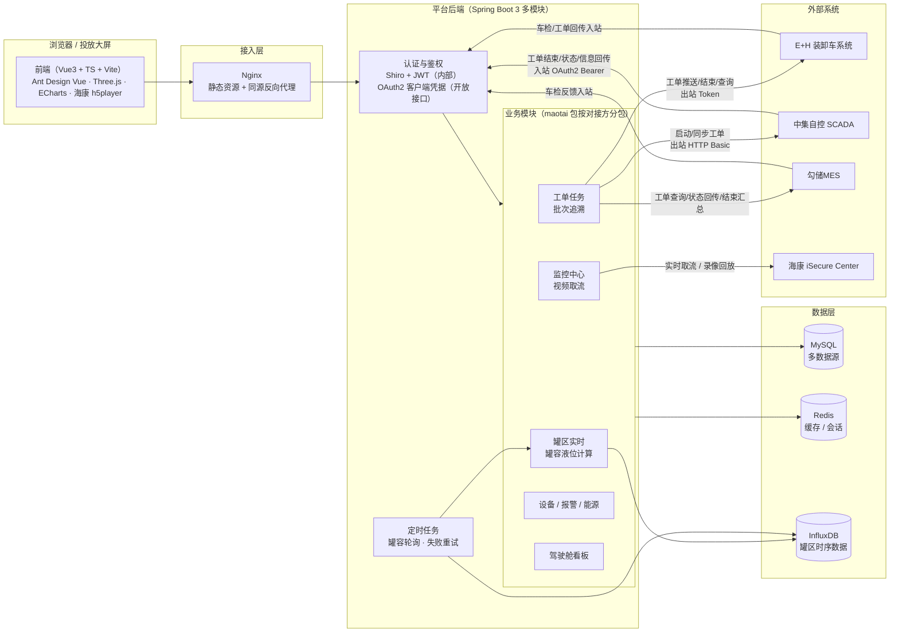

# 茅台B园区数字化平台（白酒生产数字化 MES）

面向白酒生产园区的**工单执行、批次追溯、罐区实时监控、能耗看板、视频监控**一体化平台。
对接 **E+H 装卸车系统、中集自控（SCADA）、勾储MES、海康 iSecure Center** 四类外部系统，覆盖
「装卸车 → 倒罐/灌装 → 罐存 → 批次谱系」的完整业务链路。

> 本仓库 `main` 分支为**后端**（Spring Boot 3 多模块），`frontend` 分支为**前端**（Vue3 + TS）。

## 功能总览

| 模块 | 说明 |
| --- | --- |
| 工单任务管理 | 卸车/装车/倒罐/灌装四类工艺工单，单创建与批量创建，状态机流转（待执行→执行中→暂停→完成/废弃），操作日志全程留痕 |
| 批次追溯 | 按源/目标罐+时间构建全链路酒液谱系图（BFS + 最长路径分层），打空源罐截断、跨批次祖先合并，一工单一批次 |
| 罐区实时监控 | 罐容/液位/温度/酒精度实时计算（InfluxDB 时序轮询），3D 车间视图（Three.js）与驾驶舱看板 |
| 能源看板 | 电/水/压缩空气多介质、日/周/月三周期能耗曲线与同环比 |
| 监控中心（视频） | 海康 h5player SDK 封装，1/4/9/16 分屏实时预览、录像回放、监控点树形导航 |
| 外部系统对接 | 装卸车工单推送、工单状态/信息回传、车检信息链路、工艺报警接收（20 个接口） |
| 设备/主数据 | 设备台账、报警管理、能源管理、主数据管理等配套模块 |

## 技术栈

- **后端**：Java 17 · Spring Boot 3.1.5 · MyBatis-Plus 3.5.3 · Shiro + JWT · Redis · MySQL（多数据源）· InfluxDB · JeecgBoot 3.7.1 脚手架
- **前端**：Vue 3 · TypeScript · Vite · Ant Design Vue · Three.js · ECharts · Jest + ts-jest + jsdom
- **测试**：JUnit 5 + Mockito（后端 34 例）· Jest（前端 83 例），共 **117 例自动化测试全绿**

## 架构图



## 后端模块结构

```text
keytech-calculation-biz/src/main/java/com/keytech/modules/
├── maotai/
│   ├── workorder/    # 工单任务 + 批次追溯 + 转酒路径（单号生成/撞号重试）
│   ├── tank/         # 罐区实时：InfluxDB 轮询、罐容液位计算
│   ├── eh/           # E+H 装卸车：工单推送、车检接收/回传、工单回传（Token 出站）
│   ├── scada/        # 中集自控：工单启动/同步出站（HTTP Basic）、结束/状态/信息回传入站（OAuth2）
│   ├── mes/          # 勾储MES：车检推送、工单信息回传、结束汇总、按工号查询工单落库
│   ├── hikvision/    # 海康视频：监控点分页、实时取流、录像回放（h5player 配套）
│   ├── cockpit/      # 驾驶舱：KPI 聚合、能耗、罐风险
│   ├── equipment/    # 设备台账
│   ├── alarm/        # 通用报警事件（多来源接入）
│   ├── energy/       # 能源数据
│   └── production/   # 车间预览、生产过程
└── common/           # 审计基类、通用工具
```

## 关键设计

### 外部接口三级幂等治理

| 类型 | 接口 | 治理 |
| --- | --- | --- |
| 入站·INSERT 通知类 | 工单结束/状态更新/信息回传/车检反馈/报警接收 | 请求流水 `rqi`/`requestId` 唯一索引 + 重复请求返回成功不重复落库 |
| 入站·UPDATE 类 | 工单更新通知等 | 重试写同值天然幂等 |
| 出站推送类 | 工单推送/结束/同步 | 失败落操作日志挂账，定时任务重试（3 次 × 60s），成功后自动核销 |

### 并发与一致性

- 工单号 `WO-{工艺码}{yyMM}-nnnn` 生成：`FOR UPDATE` 行锁 + 唯一索引兜底 + 撞号重试，杜绝并发重号
- 批次号按工艺/车间规则生成；批次追溯在应用层做谱系建图（BFS + 最长路径分层 + 打空源罐截断）
- 罐区实时数据以 InfluxDB 时序存储，定时轮询计算罐容液位，前端 10s 增量刷新

### 前端工程

- 业务逻辑抽纯函数模块（谱系建图 `traceGraph.ts`、能耗生成 `energyMock.ts`），单测覆盖后组件薄壳化
- Three.js 手写轨道控制与 Raycaster 拾取的 3D 车间视图；海康 h5player 无插件播放器封装（分屏/回放/截图/全屏还原）
- jest + ts-jest + jsdom 前端测试基建，与后端 Mockito 单测共同构成 117 例回归网

## 仓库分支

| 分支 | 内容 |
| --- | --- |
| `main` | 后端（本分支）：Spring Boot 3 多模块 Maven 工程，`mvn package` 构建 |
| `frontend` | 前端：Vue3 + Vite 工程，`pnpm install && pnpm dev` 本地运行 |
